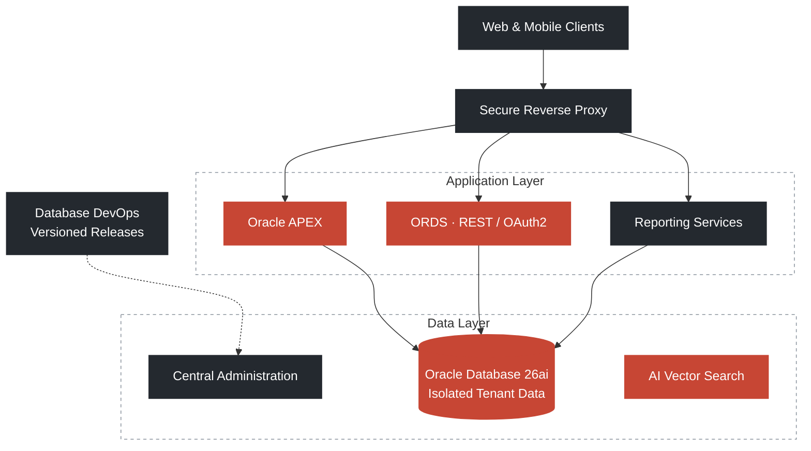

<!--
  GitHub Profile README — Malek Mohammed Al-Edresi
  Software Engineer · Oracle ACE Associate · Oracle APEX & Database Specialist
  Animated cards in assets/cards are generated by assets/generate.py
-->

  

<h1 align="center">Malek Mohammed Al-Edresi</h1>

  <b>Software Engineer&nbsp;&nbsp;·&nbsp;&nbsp;Oracle ACE Associate ♠</b>

  

  
  
  

  <a href="#about" title="Jump to About"><kbd>&nbsp;About&nbsp;</kbd></a>&nbsp;
  <a href="#impact" title="Jump to Selected Impact"><kbd>&nbsp;Impact&nbsp;</kbd></a>&nbsp;
  <a href="#expertise" title="Jump to Technical Expertise"><kbd>&nbsp;Expertise&nbsp;</kbd></a>&nbsp;
  <a href="#project" title="Jump to Featured Project"><kbd>&nbsp;Project&nbsp;</kbd></a>&nbsp;
  <a href="#certifications" title="Jump to Certifications"><kbd>&nbsp;Certifications&nbsp;</kbd></a>&nbsp;
  <a href="#activity" title="Jump to GitHub Activity"><kbd>&nbsp;Activity&nbsp;</kbd></a>&nbsp;
  <a href="#contact" title="Jump to Contact"><kbd>&nbsp;Contact&nbsp;</kbd></a>

## &nbsp; About

Software Engineer with **3+ years** of hands-on experience designing and delivering **Oracle-based enterprise applications** with Oracle APEX, Oracle Database, SQL, and PL/SQL. Recognized as an **Oracle ACE Associate** and holder of **7 Oracle certifications**.

Experienced across database architecture, multi-tenant SaaS systems, RESTful services, Docker-based deployment, DevOps automation, reporting, system integration, performance tuning, and AI-powered applications.

<picture>
  <source media="(prefers-color-scheme: dark)" srcset="assets/cards/highlights-dark.svg">
  
</picture>

## &nbsp; Selected Impact

<table>
  <thead><tr><th align="left">Area</th><th align="left">Outcome</th></tr></thead>
  <tbody>
    <tr><td nowrap>&nbsp;&nbsp;<b>Healthcare SaaS</b></td><td>Architected a multi-tenant medical center system with <b>180+ APEX screens</b>, <b>171+ tables</b>, <b>91 views</b>, and <b>100+ PL/SQL packages</b></td></tr>
    <tr><td nowrap>&nbsp;&nbsp;<b>Performance</b></td><td>Delivered <b>40% efficiency improvements</b> through advanced SQL and PL/SQL tuning</td></tr>
    <tr><td nowrap>&nbsp;&nbsp;<b>Cloud &amp; AI</b></td><td>Hands-on with OCI, Autonomous Database, Oracle 26ai, AI Vector Search, and RAG workflows</td></tr>
    <tr><td nowrap>&nbsp;&nbsp;<b>Security</b></td><td>Implemented RBAC, custom authentication, MFA/OTP, password hashing (DBMS_CRYPTO), and audit controls</td></tr>
    <tr><td nowrap>&nbsp;&nbsp;<b>DevOps</b></td><td>Liquibase-driven database DevOps, Docker containerization, and CI/CD pipeline automation</td></tr>
    <tr><td nowrap>&nbsp;&nbsp;<b>Mobile &amp; APIs</b></td><td>Built <b>20+ ORDS REST APIs</b> secured with OAuth2 and integrated them with a Flutter mobile application</td></tr>
  </tbody>
</table>

## &nbsp; Technical Expertise

<table>
  <thead><tr><th align="left">Domain</th><th align="left">Stack</th></tr></thead>
  <tbody>
    <tr><td nowrap>&nbsp;&nbsp;<b>Database</b></td><td>
      
      
      
      
    </td></tr>
    <tr><td nowrap>&nbsp;&nbsp;<b>Application</b></td><td>
      
      
      
      
    </td></tr>
    <tr><td nowrap>&nbsp;&nbsp;<b>APIs &amp; Integration</b></td><td>
      
      
      
      
      
    </td></tr>
    <tr><td nowrap>&nbsp;&nbsp;<b>Cloud &amp; DevOps</b></td><td>
      
      
      
      
      
      
    </td></tr>
    <tr><td nowrap>&nbsp;&nbsp;<b>AI &amp; Reporting</b></td><td>
      
      
      
      
    </td></tr>
  </tbody>
</table>

<b>Detailed competencies</b>&nbsp;&nbsp;click to expand

 

| Area | Capabilities |
|:-----|:-------------|
| **Oracle Database & PL/SQL** | Oracle 21c / 26ai, Autonomous Database · Advanced PL/SQL (packages, triggers, materialized views) · Query tuning, partitioning, data modeling · Schema design & multi-tenant architecture |
| **Oracle APEX & Front-End** | APEX 24.x / 26.x, Dynamic Actions, Interactive Grids · Custom plugins, HTML5, CSS3, JavaScript · RTL support, PWA, UI/UX optimization |
| **Architecture & Integration** | Multi-tenant SaaS architecture · ORDS REST APIs, OAuth2, JSON · APEX_WEB_SERVICE, REST integration · Schema isolation & dynamic tenant routing |
| **Cloud, DevOps & CI/CD** | OCI, Docker, Docker Compose · Liquibase, Git, Linux, Nginx reverse proxy · Makefile, DBMS_DATAPUMP, deployment automation |
| **Reporting & Analytics** | JasperReports Server, dashboards · Materialized views, data processing |
| **AI & Tools** | Oracle AI Vector Search, RAG, embeddings · LLM integration (Ollama), Python · SQL Developer, Postman, OpenWA, Twilio |

## &nbsp; Featured Project

### Oracle APEX Medical Center System

A **Docker-based, multi-tenant enterprise healthcare platform** built on **Oracle Database 26ai**, **ORDS**, and **Oracle APEX**.

<picture>
  <source media="(prefers-color-scheme: dark)" srcset="assets/cards/project-dark.svg">
  
</picture>

&nbsp; <b>Architecture</b>&nbsp;&nbsp;click to collapse

 

Hover over the diagram to zoom, pan, or open it full screen.

<table>
  <thead><tr><th align="left">Pillar</th><th align="left">Approach</th></tr></thead>
  <tbody>
    <tr><td nowrap>&nbsp;&nbsp;<b>Multi-Tenancy</b></td><td>Isolated tenant data model with centralized administration and secure separation between tenants</td></tr>
    <tr><td nowrap>&nbsp;&nbsp;<b>Deployment</b></td><td>Layered application, data, and reporting services behind a secure edge / reverse proxy</td></tr>
    <tr><td nowrap>&nbsp;&nbsp;<b>AI Integration</b></td><td>AI-powered semantic search and retrieval workflows for intelligent data access</td></tr>
    <tr><td nowrap>&nbsp;&nbsp;<b>DevOps Pipeline</b></td><td>Automated database change management, versioned releases, and controlled tenant deployments</td></tr>
    <tr><td nowrap>&nbsp;&nbsp;<b>Security</b></td><td>Strong tenant isolation, authentication and access controls, and comprehensive audit logging</td></tr>
  </tbody>
</table>

&nbsp; <b>Platform Modules</b>&nbsp;&nbsp;click to collapse

 

<table>
  <tr>
    <td width="33%" valign="top">&nbsp; <b>Patient & Medical Records</b> Demographics, diagnoses, treatments, billing, insurance</td>
    <td width="33%" valign="top">&nbsp; <b>Appointments & Booking</b> Scheduling, room management, service cataloging</td>
    <td width="33%" valign="top">&nbsp; <b>Employees & HR</b> Staff information, doctor schedules, departments</td>
  </tr>
  <tr>
    <td valign="top">&nbsp; <b>Laboratory</b> Lab tests, specimen tracking, test results</td>
    <td valign="top">&nbsp; <b>Radiology</b> Imaging reports, screening devices</td>
    <td valign="top">&nbsp; <b>Pharmacy</b> Drug cataloging, interactions, dosages</td>
  </tr>
  <tr>
    <td valign="top">&nbsp; <b>Store & Inventory</b> Stock management, supplier invoices</td>
    <td valign="top">&nbsp; <b>Accounting</b> Ledger mapping, expenses, AR/AP, financial KPIs</td>
    <td valign="top">&nbsp; <b>AI / RAG System</b> Document embeddings, vector chunks, AI assistants</td>
  </tr>
</table>

<a href="#readme-top" title="Back to top">Back to top ↑</a>

## &nbsp; Certifications

| Credential | Level | Year |
|:-----------|:-----:|:----:|
| Oracle Database PL/SQL Developer Certified Professional |  | 2026 |
| Oracle APEX Cloud Developer Certified Professional |  | 2025 |
| Oracle AI Vector Search Certified Professional |  | 2025 |
| Oracle Autonomous Database Cloud Certified Professional |  | 2025 |
| Oracle MySQL HeatWave Implementation Associate |  | 2025 |
| Oracle Cloud Infrastructure Foundations Associate |  | 2025 |
| Oracle Cloud Infrastructure 2025 AI Foundations Associate |  | 2025 |

## &nbsp; GitHub Activity

  
    
  <picture>
    <source media="(prefers-color-scheme: dark)" srcset="https://github-readme-stats.vercel.app/api?username=malek-al-edresi&show_icons=true&hide_border=true&hide_rank=true&count_private=true&title_color=E6EDF3&icon_color=E5735F&text_color=8B949E&bg_color=00000000">
    
  </picture>
  <picture>
    <source media="(prefers-color-scheme: dark)" srcset="https://streak-stats.demolab.com/?user=malek-al-edresi&hide_border=true&background=00000000&stroke=30363D&ring=E5735F&fire=E5735F&currStreakNum=E6EDF3&sideNums=E6EDF3&currStreakLabel=E5735F&sideLabels=8B949E&dates=8B949E">
    
  </picture>

## &nbsp; Contact

  
  
  
  

 

  Building enterprise-grade Oracle solutions&nbsp;&nbsp;·&nbsp;&nbsp;&nbsp;&nbsp;·&nbsp;&nbsp;<a href="#readme-top" title="Back to top">Back to top ↑</a>

