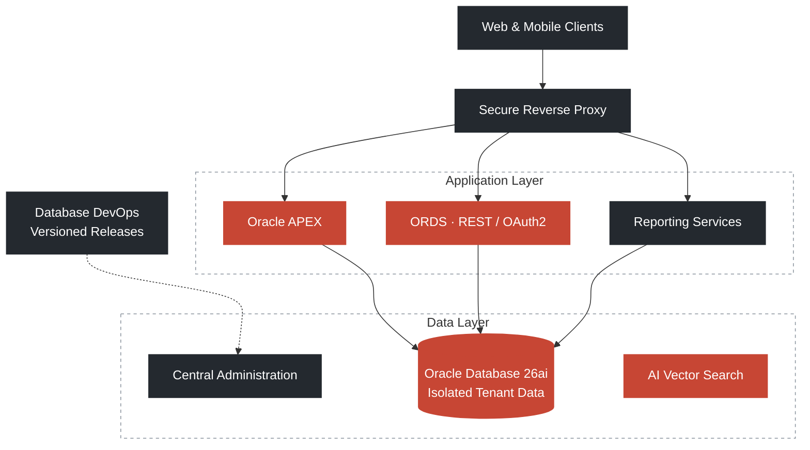

<!--
  GitHub Profile README — Malek Mohammed Al-Edresi
  Software Engineer · Oracle ACE Associate · Oracle APEX & Database Specialist
-->

  

<h1 align="center">Malek Mohammed Al-Edresi</h1>

  <b>Software Engineer&nbsp;&nbsp;·&nbsp;&nbsp;Oracle ACE Associate ♠</b>
   
  ORACLE APEX&nbsp;&nbsp;•&nbsp;&nbsp;PL/SQL &amp; DATABASE ARCHITECTURE&nbsp;&nbsp;•&nbsp;&nbsp;MULTI-TENANT SAAS&nbsp;&nbsp;•&nbsp;&nbsp;CLOUD &amp; DEVOPS&nbsp;&nbsp;•&nbsp;&nbsp;AI VECTOR SEARCH

  
  
  

 

## About

Software Engineer with **3+ years** of hands-on experience designing and delivering **Oracle-based enterprise applications** with Oracle APEX, Oracle Database, SQL, and PL/SQL. Recognized as an **Oracle ACE Associate** and holder of **7 Oracle certifications**.

Experienced across database architecture, multi-tenant SaaS systems, RESTful services, Docker-based deployment, DevOps automation, reporting, system integration, performance tuning, and AI-powered applications.

<table>
  <tr>
    <td align="center" width="190"><h3>3+</h3>YEARS OF ORACLE ENTERPRISE DELIVERY</td>
    <td align="center" width="190"><h3>7</h3>ORACLE CERTIFICATIONS</td>
    <td align="center" width="190"><h3>180+</h3>APEX SCREENS IN ONE PLATFORM</td>
    <td align="center" width="190"><h3>40%</h3>EFFICIENCY GAIN FROM SQL &amp; PL/SQL TUNING</td>
  </tr>
</table>

## Selected Impact

| Area | Outcome |
|:-----|:--------|
| **Healthcare SaaS Platform** | Architected a multi-tenant medical center system with **180+ APEX screens**, **171+ tables**, **91 views**, and **100+ PL/SQL packages** |
| **Performance Engineering** | Delivered **40% efficiency improvements** through advanced SQL and PL/SQL tuning |
| **Cloud & AI** | Hands-on with OCI, Autonomous Database, Oracle 26ai, AI Vector Search, and RAG workflows |
| **Security Architecture** | Implemented RBAC, custom authentication, MFA/OTP, password hashing (DBMS_CRYPTO), and audit controls |
| **DevOps Automation** | Liquibase-driven database DevOps, Docker containerization, and CI/CD pipeline automation |
| **Mobile Integration** | Built **20+ ORDS REST APIs** secured with OAuth2 and integrated them with a Flutter mobile application |

## Technical Expertise

| Domain | Stack |
|:-------|:------|
| **Database** |     |
| **Application** |     |
| **APIs & Integration** |      |
| **Cloud & DevOps** |       |
| **AI & Reporting** |     |

<b>Detailed competencies</b>

 

| Area | Capabilities |
|:-----|:-------------|
| **Oracle Database & PL/SQL** | Oracle 21c / 26ai, Autonomous Database · Advanced PL/SQL (packages, triggers, materialized views) · Query tuning, partitioning, data modeling · Schema design & multi-tenant architecture |
| **Oracle APEX & Front-End** | APEX 24.x / 26.x, Dynamic Actions, Interactive Grids · Custom plugins, HTML5, CSS3, JavaScript · RTL support, PWA, UI/UX optimization |
| **Architecture & Integration** | Multi-tenant SaaS architecture · ORDS REST APIs, OAuth2, JSON · APEX_WEB_SERVICE, REST integration · Schema isolation & dynamic tenant routing |
| **Cloud, DevOps & CI/CD** | OCI, Docker, Docker Compose · Liquibase, Git, Linux, Nginx reverse proxy · Makefile, DBMS_DATAPUMP, deployment automation |
| **Reporting & Analytics** | JasperReports Server, dashboards · Materialized views, data processing |
| **AI & Tools** | Oracle AI Vector Search, RAG, embeddings · LLM integration (Ollama), Python · SQL Developer, Postman, OpenWA, Twilio |

## Featured Project

### Oracle APEX Medical Center System

A **Docker-based, multi-tenant enterprise healthcare platform** built on **Oracle Database 26ai**, **ORDS**, and **Oracle APEX**.

<table>
  <tr>
    <td align="center" width="110"><h3>180+</h3>APEX SCREENS</td>
    <td align="center" width="110"><h3>171+</h3>TABLES &nbsp;</td>
    <td align="center" width="110"><h3>91</h3>VIEWS &nbsp;</td>
    <td align="center" width="110"><h3>100+</h3>PL/SQL PACKAGES</td>
    <td align="center" width="110"><h3>174</h3>TRIGGERS &nbsp;</td>
    <td align="center" width="110"><h3>413</h3>INDEXES &nbsp;</td>
    <td align="center" width="110"><h3>20+</h3>ORDS REST APIS</td>
  </tr>
</table>

#### Architecture

| Pillar | Approach |
|:-------|:---------|
| **Multi-Tenancy** | Isolated tenant data model with centralized administration and secure separation between tenants |
| **Deployment** | Layered application, data, and reporting services behind a secure edge / reverse proxy |
| **AI Integration** | AI-powered semantic search and retrieval workflows for intelligent data access |
| **DevOps Pipeline** | Automated database change management, versioned releases, and controlled tenant deployments |
| **Security** | Strong tenant isolation, authentication and access controls, and comprehensive audit logging |

#### Platform Modules

<table>
  <tr>
    <td width="33%" valign="top"><b>Patient & Medical Records</b> Demographics, diagnoses, treatments, billing, insurance</td>
    <td width="33%" valign="top"><b>Appointments & Booking</b> Scheduling, room management, service cataloging</td>
    <td width="33%" valign="top"><b>Employees & HR</b> Staff information, doctor schedules, departments</td>
  </tr>
  <tr>
    <td valign="top"><b>Laboratory</b> Lab tests, specimen tracking, test results</td>
    <td valign="top"><b>Radiology</b> Imaging reports, screening devices</td>
    <td valign="top"><b>Pharmacy</b> Drug cataloging, interactions, dosages</td>
  </tr>
  <tr>
    <td valign="top"><b>Store & Inventory</b> Stock management, supplier invoices</td>
    <td valign="top"><b>Accounting</b> Ledger mapping, expenses, AR/AP, financial KPIs</td>
    <td valign="top"><b>AI / RAG System</b> Document embeddings, vector chunks, AI assistants</td>
  </tr>
</table>

## Certifications

| Credential | Level | Year |
|:-----------|:-----:|:----:|
| Oracle Database PL/SQL Developer Certified Professional | Professional | 2026 |
| Oracle APEX Cloud Developer Certified Professional | Professional | 2025 |
| Oracle AI Vector Search Certified Professional | Professional | 2025 |
| Oracle Autonomous Database Cloud Certified Professional | Professional | 2025 |
| Oracle MySQL HeatWave Implementation Associate | Associate | 2025 |
| Oracle Cloud Infrastructure Foundations Associate | Associate | 2025 |
| Oracle Cloud Infrastructure 2025 AI Foundations Associate | Associate | 2025 |

## GitHub Activity

  
    
  <picture>
    <source media="(prefers-color-scheme: dark)" srcset="https://github-readme-stats.vercel.app/api?username=malek-al-edresi&show_icons=true&hide_border=true&hide_rank=true&count_private=true&title_color=E6EDF3&icon_color=E5735F&text_color=8B949E&bg_color=00000000">
    
  </picture>
  <picture>
    <source media="(prefers-color-scheme: dark)" srcset="https://streak-stats.demolab.com/?user=malek-al-edresi&hide_border=true&background=00000000&stroke=30363D&ring=E5735F&fire=E5735F&currStreakNum=E6EDF3&sideNums=E6EDF3&currStreakLabel=E5735F&sideLabels=8B949E&dates=8B949E">
    
  </picture>

## Contact

  
  
  
  

 

  Building enterprise-grade Oracle solutions&nbsp;&nbsp;·&nbsp;&nbsp;

